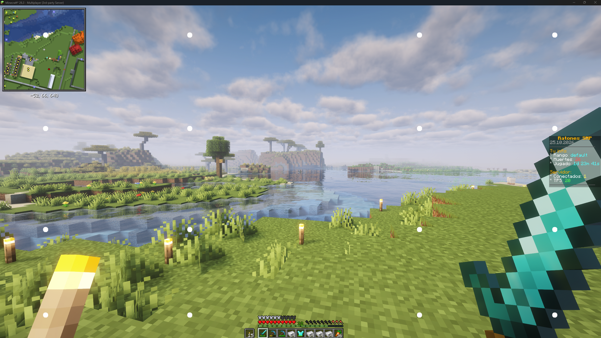

# Motion Anchor


Motion Anchor is a client-side Fabric mod for Minecraft 26.3. It draws 16
white dots in a fixed, reference-matched layout directly in the game's HUD.
Their positions scale with Minecraft's GUI resolution and do not intercept
input. Press **O** (configurable in Minecraft's Controls settings) to toggle
them.

## Build and install

1. Build the mod from source with Java 25 by running `.\gradlew.bat build`.
2. Install Fabric Loader 0.19.5+ for Minecraft 26.3 and Fabric API 0.162.0+26.3
   in the same profile.
3. Copy `build\libs\motion-anchor-1.0.2.jar` into that profile's `mods` folder.
4. Launch the Fabric profile.

The mod is client-only and does not need to be installed on a server. It is
Modrinth-compatible, but has not yet been published as a Modrinth project.
The built JAR is written to `build\libs\motion-anchor-1.0.2.jar`.

## Riot Vanguard

Unlike the legacy Windows overlay, this mod draws only inside Minecraft and
does not create a separate always-on-top desktop window. It cannot guarantee
Riot Vanguard compatibility or prevent Vanguard from flagging other software.
Close Minecraft before launching League of Legends if Vanguard has raised a
warning, and contact Riot Support about Vanguard alerts.

The previous Windows overlay source is retained in `MotionAnchor.csproj`,
`OverlayForm.cs`, and related files; do not run that overlay alongside Riot
games.

## In-game screenshot



## Modrinth project listing

**Project name:** Motion Anchor

**Suggested slug:** `motion-anchor`

**Summary:** Adds 16 configurable white reference dots to the Minecraft HUD.

**Description (copy-ready):**

```text
Motion Anchor is a lightweight, client-side Fabric mod that draws 16 round white dots over the Minecraft HUD in a fixed layout inspired by motion-reference overlays. The dots scale with your GUI resolution and never interfere with your controls.

Features:
• 16 round white dots in a fixed, resolution-scaled layout.
• Press O to show or hide the dots. You can rebind the key in Options → Controls → Key Binds.
• Client-side only; no server installation is required.

Requirements: Minecraft 26.3, Fabric Loader 0.19.5 or later, Fabric API 0.162.0+26.3 or later, and Java 25.

Motion Anchor renders only inside Minecraft. It is not a desktop overlay or a Vanguard bypass, and compatibility with Riot Vanguard is not guaranteed.
```

**Suggested categories and tags:** Fabric, Client-side, Utility, Accessibility, HUD, motion sickness

**Supported Minecraft version:** 26.3

**License:** Select the license that matches the project's source license when creating the Modrinth project.
